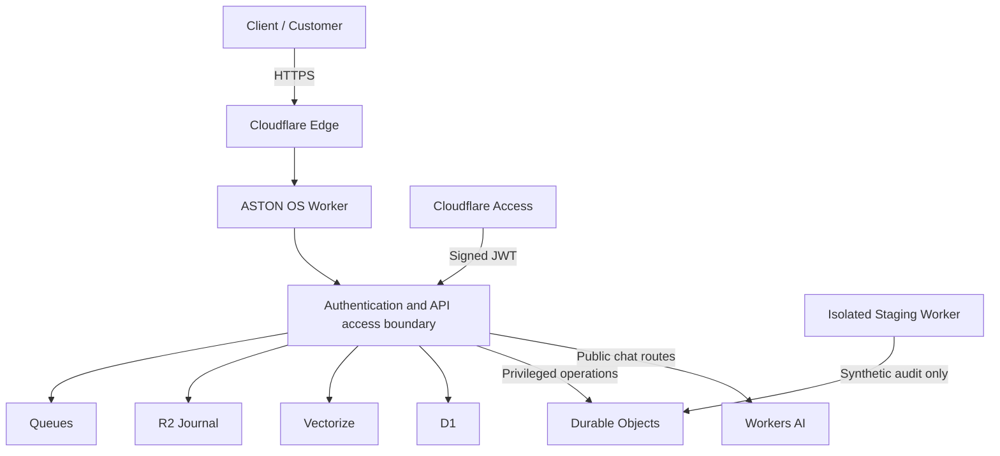

# ASTON OS — initial threat model

**Scope:** Cloudflare Worker API and configured Cloudflare data/AI services.  
**Method:** lightweight trust-boundary review; not a formal STRIDE assessment or penetration test.

## Assets

API credentials and Access assertions; tenant identity, roles and plan; prompts, uploaded/RAG documents, embeddings and responses; agent plans, risk envelopes, approvals, incidents, audit logs and lineage; production/staging configuration and deployment credentials.

## Trust boundaries and data flow

## Threats and mitigations

| Threat | Example | Mitigation present in this branch | Residual risk |
|---|---|---|---|
| Tenant spoofing | Caller supplies another tenant in X-Aston-Tenant | Anonymous identity uses fixed public tenant; authenticated tenant comes from verified claim | Route-level tenant scoping and existing data need integration tests |
| Privilege escalation | Caller selects X-Aston-Plan: gov or writes as viewer | Plan derives from trusted claim/server role; protected writes require admin/executor | Access custom roles and Cloudflare policy need account review |
| Forged identity | Expired JWT, wrong audience, forged signature | RS256, issuer, signature, exp/nbf and configured audience checks | JWKS rotation/cache and negative JWT vectors need further tests |
| Unauthorized data access | Anonymous reads audit or tenant records; Access user lacks tenant claim | Private GET routes require identity; missing/invalid Access tenant claims receive an actor-specific unassigned tenant rather than shared default | Configure explicit tenant claims for organization collaboration and verify every downstream tenant filter |
| Unauthorized mutation | Anonymous/viewer changes policy, agents or infrastructure | Explicit public POST allowlist; other writes require privileged identity | Review allowlist whenever routes change |
| Secret disclosure | API key appears in logs or repository | Gitleaks; API key actor label uses SHA-256 fingerprint; runtime secret storage | Audit all logs, CI artifacts, Cloudflare secrets and history |
| Prompt injection / unsafe output | User content manipulates agents or leaks credentials | Staging SafetyInterlock and narrow credential-pattern output guard | Not semantic prompt-injection detection or complete DLP |
| Resource exhaustion | Unbounded public AI calls, chunked oversized bodies, or repeated API requests | Streamed plan-based body limits; per-IP and per-tenant fixed-window Durable Object limits; tighter public chat quotas | Tune thresholds from production telemetry and add Cloudflare edge-level volumetric protection |
| Staging contamination | Staging points at production bindings | Separate staging Wrangler config and dry-run workflow | Verify live Workers Builds settings, secrets, routes and bindings before deploy |
| Supply-chain compromise | Vulnerable npm package or workflow action | Dependabot, Gitleaks, npm audit and existing pinned Actions | SLSA provenance, SBOM and action-pin review remain open |

## Phase 3 — Zero Trust and continuous assurance

- SafetyInterlock records agent policy decisions and human approval outcomes in a tenant-scoped SHA-256 hash chain.
- Audit event rows are append-only at the SQLite layer: UPDATE and DELETE triggers abort mutations.
- Each tenant chain starts at `GENESIS`; a unique `(tenant, previous_hash)` constraint prevents concurrent writers from creating two successors to the same event.
- `/audit/verify?tenant=...` verifies chain linkage and record hashes and returns only integrity status and event count.
- Audit payloads deliberately exclude prompts, source code, credentials, and full request bodies; they record tool, decision, risk, score, policy reasons, approval ID, and actor lineage.
- Hash chaining is tamper-evidence, not an external immutable/WORM backup: an administrator able to replace the entire Durable Object database could rewrite the chain. Export/anchoring and retention remain follow-up controls.
- The Durable Object `/audit/verify` route remains internal. A private read-only Worker facade, `GET /v1/engineering/audit/verify`, now requires a verified `admin` or `executor`, selects `audit:<verified-tenant>`, rejects caller-supplied tenant overrides, and returns only integrity status, event count, and an ephemeral evidence digest; no tenant identifier or tenant-derived pseudonym is returned. It does not expose audit event payloads. An empty chain is reported distinctly and does not prove audit coverage.

## External audit anchoring — Phase 3 extension

- Tenant roots are checkpointed to a dedicated R2 bucket after each 100 new events and hourly when activity exists.
- Checkpoint keys include tenant hash, event count, and root hash; exact-content checks prevent accidental reuse of a key with different bytes.
- The scheduled OpenTimestamps workflow stamps checkpoint bytes, upgrades pending receipts, and publishes a final receipt only after the CLI reports a Bitcoin block confirmation.
- Runtime verification is delegated to the separately deployed `OTS_VERIFIER` service binding. The Worker fails closed (503) when the R2 receipt or verifier is unavailable and rejects local-root mismatches (409).
- R2 evidence objects use the evidence/ prefix; mutable OTS upgrade proofs stay under pending/ outside the retention scope. The staging Wrangler config binds the dedicated aston-audit-archive bucket, but account-level lock state and credentials still require operator verification.
- A Cloudflare account administrator may still alter bucket configuration or remove lock rules. Separate duties and retain independent copies of proofs; do not claim protection against compromise of every privileged account.
- The Trust Fabric service-binding E2E remains pending until its runtime service and the staging binding are configured.

## Assumptions

- Access JWTs are accepted only when team domain and audience are configured.
- API keys and audit secrets are stored as runtime secrets.
- Staging uses synthetic data and is not connected to production D1, queues, R2, Vectorize or sessions.
- Cloudflare physical security and at-rest encryption require provider evidence; repository code cannot prove them.

## Release-blocking follow-up

1. Run route-by-route authorization and tenant-isolation tests.
2. Add streaming body limits and per-tenant rate limiting.
3. Review every Durable Object method and mutating endpoint.
4. Verify Access MFA, account roles, Worker secrets, bindings, routes, and Workers Builds commands.
5. Test backup restoration and incident response.
6. Commission independent penetration testing before claiming enterprise assurance.
