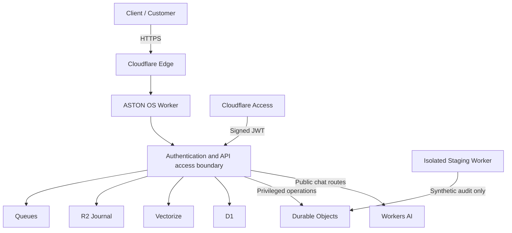

# ASTON OS — initial threat model

**Scope:** Cloudflare Worker API and configured Cloudflare data/AI services.  
**Method:** lightweight trust-boundary review; not a formal STRIDE assessment or penetration test.

## Assets

API credentials and Access assertions; tenant identity, roles and plan; prompts, uploaded/RAG documents, embeddings and responses; agent plans, risk envelopes, approvals, incidents, audit logs and lineage; production/staging configuration and deployment credentials.

## Trust boundaries and data flow

## Threats and mitigations

| Threat | Example | Mitigation present in this branch | Residual risk |
|---|---|---|---|
| Tenant spoofing | Caller supplies another tenant in X-Aston-Tenant | Anonymous identity uses fixed public tenant; authenticated tenant comes from verified claim | Route-level tenant scoping and existing data need integration tests |
| Privilege escalation | Caller selects X-Aston-Plan: gov or writes as viewer | Plan derives from trusted claim/server role; protected writes require admin/executor | Access custom roles and Cloudflare policy need account review |
| Forged identity | Expired JWT, wrong audience, forged signature | RS256, issuer, signature, exp/nbf and configured audience checks | JWKS rotation/cache and negative JWT vectors need further tests |
| Unauthorized data access | Anonymous reads audit or tenant records | Private GET routes require identity | Verify every endpoint and downstream tenant filter |
| Unauthorized mutation | Anonymous/viewer changes policy, agents or infrastructure | Explicit public POST allowlist; other writes require privileged identity | Review allowlist whenever routes change |
| Secret disclosure | API key appears in logs or repository | Gitleaks; API key actor label uses SHA-256 fingerprint; runtime secret storage | Audit all logs, CI artifacts, Cloudflare secrets and history |
| Prompt injection / unsafe output | User content manipulates agents or leaks credentials | Staging SafetyInterlock and narrow credential-pattern output guard | Not semantic prompt-injection detection or complete DLP |
| Resource exhaustion | Unbounded public AI calls or large bodies | Endpoint-specific bounds and staging audit quotas | Global streaming body limits, per-tenant rate limits and abuse monitoring remain open |
| Staging contamination | Staging points at production bindings | Separate staging Wrangler config and dry-run workflow | Verify live Workers Builds settings, secrets, routes and bindings before deploy |
| Supply-chain compromise | Vulnerable npm package or workflow action | Dependabot, Gitleaks, npm audit and existing pinned Actions | SLSA provenance, SBOM and action-pin review remain open |

## Assumptions

- Access JWTs are accepted only when team domain and audience are configured.
- API keys and audit secrets are stored as runtime secrets.
- Staging uses synthetic data and is not connected to production D1, queues, R2, Vectorize or sessions.
- Cloudflare physical security and at-rest encryption require provider evidence; repository code cannot prove them.

## Release-blocking follow-up

1. Run route-by-route authorization and tenant-isolation tests.
2. Add streaming body limits and per-tenant rate limiting.
3. Review every Durable Object method and mutating endpoint.
4. Verify Access MFA, account roles, Worker secrets, bindings, routes, and Workers Builds commands.
5. Test backup restoration and incident response.
6. Commission independent penetration testing before claiming enterprise assurance.
